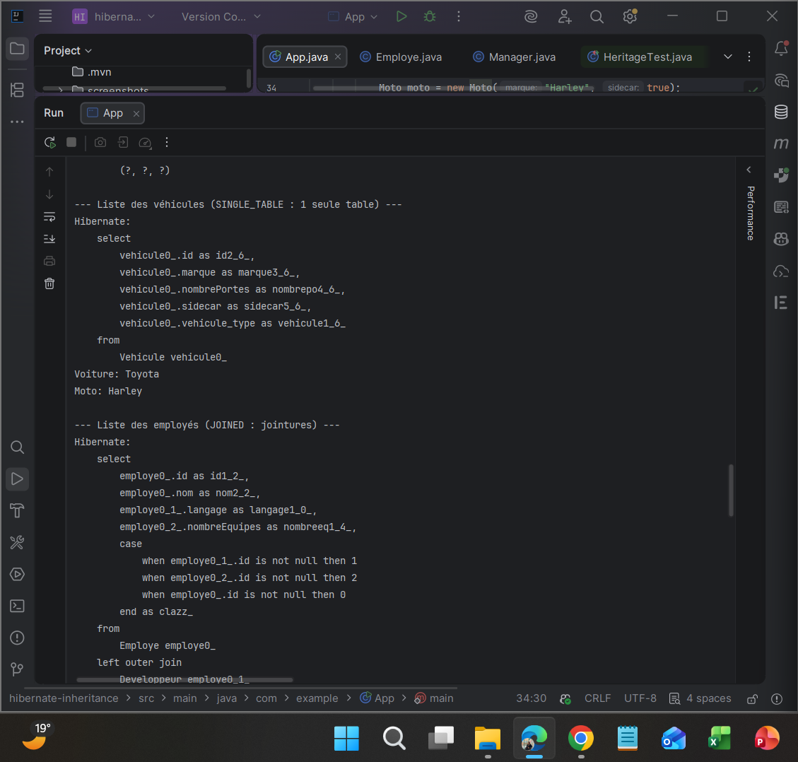
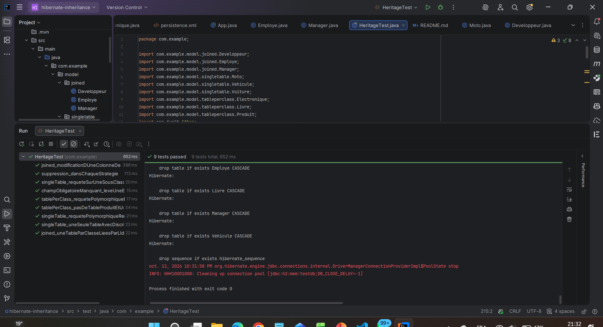

# TP4 – Héritage JPA / Hibernate : SINGLE_TABLE, JOINED, TABLE_PER_CLASS

Application Java SE qui compare les **trois stratégies d'héritage** de JPA avec Hibernate et une base **H2 en mémoire**, à travers des opérations CRUD et l'observation du SQL généré.

## Technologies

| Outil | Version |
|---|---|
| Java (compilation) | 11 |
| Hibernate ORM | 5.6.15.Final |
| JPA (`javax.persistence`) | 2.2 |
| H2 Database | 2.1.214 |
| JUnit | 4.13.2 |
| Maven | 3 |

## Architecture

```
src/
├── main/
│   ├── java/com/example/
│   │   ├── App.java                      démonstration CRUD des 3 stratégies
│   │   └── model/
│   │       ├── singletable/              Vehicule (abstraite), Voiture, Moto
│   │       ├── joined/                   Employe (abstraite), Developpeur, Manager
│   │       └── tableperclass/            Produit (abstraite), Livre, Electronique
│   └── resources/META-INF/persistence.xml
└── test/java/com/example/
    └── HeritageTest.java                 9 tests JUnit
```

## Les trois stratégies

| Stratégie | Hiérarchie | Tables créées | Lecture polymorphique |
|---|---|---|---|
| `SINGLE_TABLE` | Vehicule → Voiture, Moto | **1** table `Vehicule` + colonne discriminante `vehicule_type` | Un simple `SELECT` |
| `JOINED` | Employe → Developpeur, Manager | **3** tables, les filles référencent `Employe.id` | `SELECT` avec **jointures** |
| `TABLE_PER_CLASS` | Produit → Livre, Electronique | **2** tables complètes, **aucune** table `Produit` | `SELECT ... UNION ...` |

| Stratégie | ✅ Avantages | ❌ Inconvénients |
|---|---|---|
| `SINGLE_TABLE` | Le plus rapide, schéma simple | Colonnes NULL, pas de `NOT NULL` sur les champs des sous-classes |
| `JOINED` | Normalisé, contraintes possibles sur chaque sous-classe | Jointures à chaque lecture |
| `TABLE_PER_CLASS` | Tables indépendantes, pas de jointure pour une sous-classe | Colonnes dupliquées, `UNION` coûteux |

Choix de conception :
- En `SINGLE_TABLE`, les champs propres aux sous-classes sont des **wrappers** (`Integer`, `Boolean`) : la colonne d'une voiture est forcément NULL sur une ligne de moto.
- En `JOINED`, la colonne `langage` peut être **obligatoire** (`nullable = false`), ce qui est impossible en table unique.
- En `TABLE_PER_CLASS`, l'id utilise `GenerationType.AUTO` (séquence commune) et **pas** `IDENTITY` : avec un compteur par table, un livre et un produit électronique pourraient avoir le même id.
- La colonne discriminante `vehicule_type` est **indexée**, comme le recommande le TP.

## Démonstration (`App`)

Création des 6 entités, lecture polymorphique de chaque hiérarchie, modification d'un développeur (dirty checking) et suppression d'une moto.

```bash
mvn clean compile exec:java
```

Sortie attendue :

```
--- Liste des véhicules (SINGLE_TABLE : 1 seule table) ---
Voiture: Toyota
Moto: Harley
--- Liste des employés (JOINED : jointures) ---
Developpeur: Alice
Manager: Bob
--- Liste des produits (TABLE_PER_CLASS : UNION) ---
Livre: Clean Code
Electronique: Smartphone
```



## Tests

Une seule `EntityManagerFactory` partagée (`@BeforeClass`), un `EntityManager` neuf par test, et la base vidée après chaque test.

| Test | Ce qui est vérifié |
|---|---|
| `singleTable_requetePolymorphiqueRenvoieLesBonsTypes` | Hibernate recrée le bon type (`Voiture` / `Moto`) |
| `singleTable_uneSeuleTableAvecDiscriminateur` | Une seule table, valeurs `VOITURE` / `MOTO` dans `vehicule_type` |
| `singleTable_requeteSurUneSousClasseFiltreParLeDiscriminateur` | `SELECT v FROM Voiture v` ne renvoie que les voitures |
| `joined_uneTableParClasseLieesParLId` | 3 tables, lignes réparties entre mère et filles |
| `joined_modificationDUneColonneDeLaSousClasse` | UPDATE sur une colonne de la table fille |
| `tablePerClass_pasDeTableProduitEtUneTableParClasseConcrete` | Aucune table pour la classe abstraite |
| `tablePerClass_requetePolymorphiqueEtIdsUniques` | `UNION` et ids uniques sur toute la hiérarchie |
| `suppression_dansChaqueStrategie` | DELETE dans les 3 stratégies (en JOINED, les 2 tables) |
| `champObligatoireManquant_leveUneExceptionEtRollback` | Cas d'erreur : exception et rollback |

```bash
mvn clean test
```

